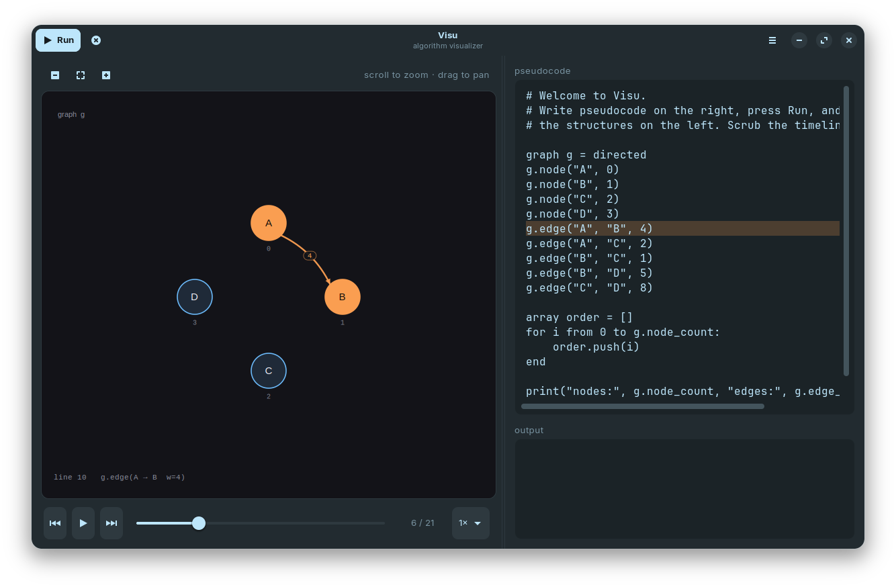
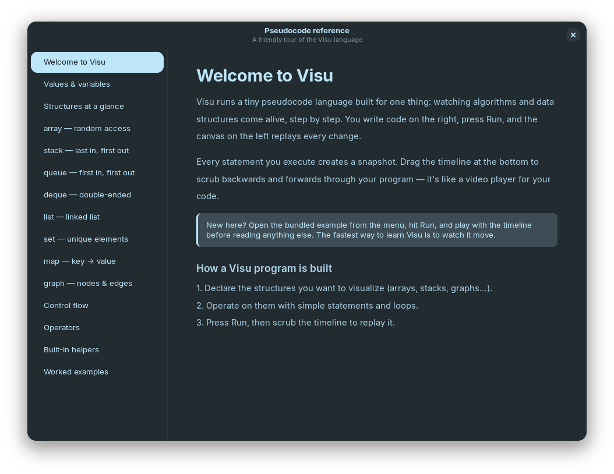

When I was learning algorithms, the hardest part was never the code itself. It was the gap between what I wrote and what I *imagined* was happening in memory. A stack grows, a queue shifts, a graph gets traversed... and all of that lives only in your head while you stare at lines of text.

So I built **Visu**, a small desktop app that tries to close that gap.

## What is Visu?

Visu is an interactive algorithm visualizer built with **Python, GTK 4 and libadwaita**. You write pseudocode in the editor, press **Run**, and the canvas replays every step on the structures you declared. At the bottom there's a timeline you can scrub backwards and forwards, like a video player for your code.



What it can do:

- **A small pseudocode language** made for this: readable, with no setup
- **Eight built-in structures**: `array`, `stack`, `queue`, `deque`, `list`, `set`, `map` and directed/undirected `graph`, each with its own animated renderer
- **Step-by-step timeline**: play, pause, step, scrub and change the speed
- **Live line highlighting**, so you always see which statement is running
- **Built-in reference** (`F1`) with examples for every structure and helper
- **Bundled examples**: bubble, insertion and selection sort, quicksort, DFS, union-find
- **Per-structure zoom and pan**, a light/dark theme, and **MP4 export** of the animation



Under the hood there's a recursive-descent parser, a runtime that records a snapshot after every step (with limits so an infinite loop can't freeze the app), and an animator that tweens each structure between snapshots. The test suite grew to almost **16,000 tests**, which made adding features much less scary.

## Why Flathub?

Building something that runs on *my* machine is one thing. Making it easy for anyone on Linux to install with one command is something else. Flathub is the main place where Linux desktop apps are distributed as Flatpaks, so it was the obvious target:

```bash
flatpak install flathub io.github.iionel.Visu
```

It was also my first real contribution to an open source ecosystem bigger than my own repos. And I learned a lot, mostly by making mistakes in public. 😅

## How the submission went

### Mistake #1: wrong branch

My first pull request went to the wrong branch. New apps have to target the `new-pr` branch, not `master`. A bot closed it within seconds. Fair enough.

### Mistake #2: deleting the PR template

In the second PR I deleted the pull request template because I thought it was just boilerplate. It isn't. The template is a checklist that confirms you've read the requirements, and a reviewer told me plainly that a PR without it won't be reviewed. Lesson: **the template is part of the submission.**

### The actual review

Once the PR was in proper shape, the reviewers left short, precise comments:

- **Use the latest GNOME runtime** (50 at the time)
- **Add basic CI** to the project
- **Pin the source to a specific commit**
- The linter asked for a `vcs-browser` URL in the AppStream metainfo

### Mistake #3: opening a new PR instead of updating the old one

After fixing everything, I closed my PR and opened a fresh one with "all feedback addressed". I thought I was keeping things clean. In fact I was making the reviewers' job harder, because the whole discussion lived in the old PR. A maintainer pointed me to the docs: *at no point during the submission process is it necessary to close the pull request.* I apologized, reopened the original, and closed the duplicate.

### The build that worked but didn't run

Then came the best lesson of all. The test build **succeeded** on both x86_64 and aarch64. Green checkmarks everywhere. But when the reviewer actually ran the app:

```
ModuleNotFoundError: No module named 'imageio'
```

I had added MP4 export a few days earlier, which pulled in `imageio`, `imageio-ffmpeg`, `numpy` and `Pillow`. I listed them in `pyproject.toml` but never bundled them in the Flatpak. Flatpak builds run in a sandbox with **no network access**, so every Python dependency has to be declared as a module with pinned wheels and checksums (a `python3-modules.yaml`). On my machine everything worked because those packages were already installed system-wide.

A successful build doesn't prove the app runs. **Test the Flatpak itself**, not your local environment.

This was the part I understood least, so I used Claude to help me put the Python modules file together. I said so in the PR, because the commit had a co-authored-by trailer, and I checked the wheels and tested the build locally with `flatpak-builder` before pushing. Being open about how the work was done felt like the right call.

### Merged 🎉

After that fix, the reviewer ran the merge command and the bot created the repository [`flathub/io.github.iionel.Visu`](https://github.com/flathub/io.github.iionel.Visu). A few hours later, Visu was live on Flathub.

## What I learned

- **Read the docs before you open the PR, not after.** Almost every mistake I made was already answered in the Flathub submission guide.
- **Reviewers are volunteers.** Their comments are short because they review a lot of PRs. Make their job easy: one PR, a complete template, clear replies.
- **Sandboxing changes everything.** No network at build time means you have to know and pin *every* dependency. It's a great way to find out what your app really depends on.
- **Mistakes in public are fine.** Nobody was rude. They pointed me to the right place and moved on. The open source community is much more welcoming than it looks from outside.
- **Shipping is a skill of its own.** Packaging, metadata, screenshots, CI, versioning... none of it is "the code", but all of it is part of a real product.

## What's next

Visu is now something I *maintain*, not just something I built. Next I want to add more examples, support weighted graphs so Dijkstra and A* can be visualized, and keep the Flathub package up to date with each release.

If you're learning algorithms, or teaching them, give it a try:

- 📦 [Visu on Flathub](https://flathub.org/apps/io.github.iionel.Visu)
- 💻 [Source code on GitHub](https://github.com/iIonel/Visu)

Issues, ideas and PRs are welcome. After all, that's how I got here too. 🙂
